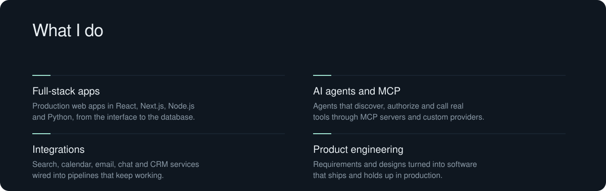
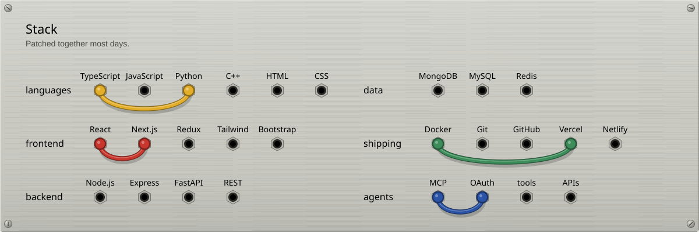
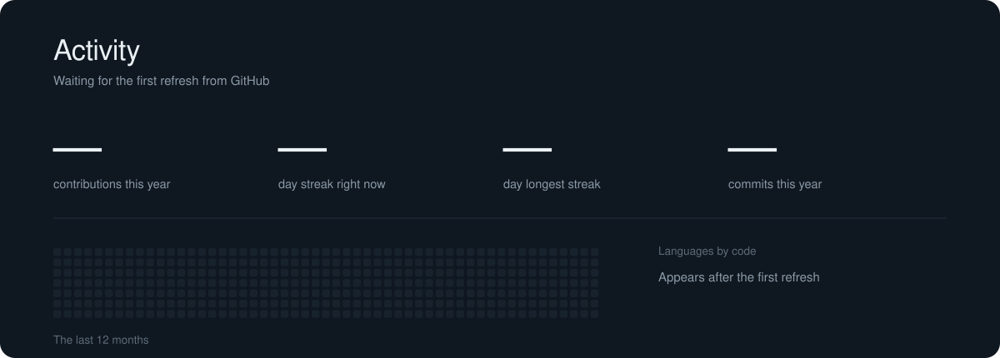

I build software products, full-stack applications and AI-powered workflows, and I like taking an idea all the way from a rough spec to something people use. Most of my recent work is about connecting AI agents to real tools: discovering what a tool can do, getting the right authorization, calling it correctly and turning the result into something useful.

Right now I'm most interested in building products from scratch, agent tool orchestration, backend systems that scale, developer tools and automation, and open-source work with other engineers. If you're building something in that space, I'd like to hear about it.

